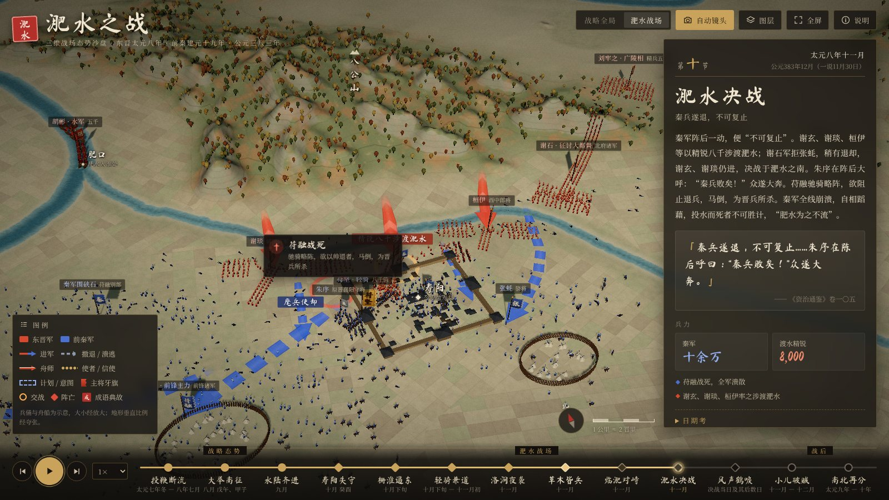
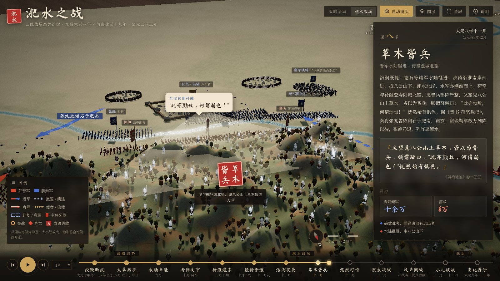
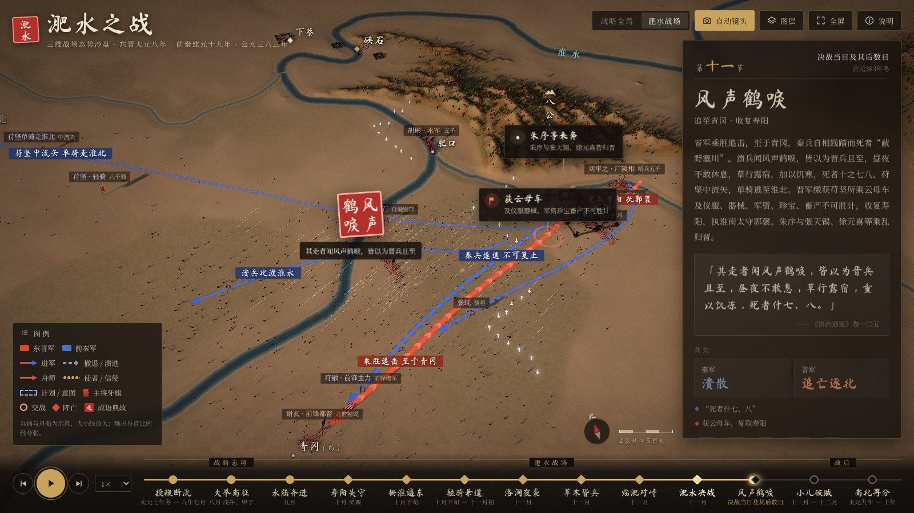

# 淝水之战 · 三维战场态势沙盘

东晋太元八年（前秦建元十九年，公元 383 年）淝水之战的三维战场模型。两座以真实高程制作的沙盘，一座展示从长安到建康的战略全局，一座展示寿阳—八公山—洛涧一带的战场；沿十三个时间节点，演示两军的进军路线、交战经过与战场态势变化，并标注关键地点、日期和史料原文。



## 打开方式

- **直接打开**：双击 [`docs/index.html`](docs/index.html)。这是一个约 2.6 MB 的单文件，地形、字体和程序都已内嵌，不需要服务器，离线也能看。
- **GitHub Pages**：在仓库 Settings → Pages 中选择 `main` 分支的 `/docs` 目录，即可得到在线地址。
- 需要支持 WebGL 2 的浏览器（新版 Chrome、Edge、Firefox、Safari 均可）。

操作：拖动旋转，滚轮缩放，右键平移；空格键播放或暂停，← / → 切换时间节点。右上角可切换沙盘、开关自动镜头，并在“图层”里调节地名、古今对照、路线、等高线、方格网、地形夸张倍数和画质。

## 内容

| 节点 | 史书日期 | 公历（儒略历） | 沙盘 | 事件 |
|---|---|---|---|---|
| 一 投鞭断流 | 太元七年冬—八年七月 | 382 冬—383.8 | 全局 | 太极殿议伐晋；桓冲攻襄阳，苻叡、慕容垂往救 |
| 二 大举南征 | 八月戊午、甲子 | 383.9.14、9.20 | 全局 | 苻融督前锋二十五万；苻坚发长安，“前后千里” |
| 三 水陆齐进 | 九月 | 10.13—11.10 | 全局 | 坚至项城，融至颍口；凉州、蜀汉、幽冀之兵在途；谢石、谢玄八万北上，胡彬援寿阳 |
| 四 寿阳失守 | 十月癸酉 | 11.28 | 战场 | 苻融渡淮克寿阳；胡彬退保硖石 |
| 五 栅淮遏东 | 十月下旬 | 约 12 月初 | 战场 | 梁成五万屯洛涧、栅淮；晋军营于洛涧东二十五里 |
| 六 轻骑兼道 | 十月下旬—十一月初 | 约 12 月上旬 | 战场 | 胡彬告急使被获；苻坚轻骑八千赴寿阳；朱序献策 |
| 七 洛涧夜袭 | 十一月 | 12 月 | 战场 | 刘牢之五千破梁成，斩成，秦军死者万五千 |
| 八 草木皆兵 | 十一月 | 12 月 | 战场 | 晋军水陆继进至八公山下；苻坚登城北望 |
| 九 临淝对峙 | 十一月 | 12 月 | 战场 | 谢玄请秦军“移陈少却”；苻坚欲半渡而击 |
| 十 淝水决战 | 十一月（一说十月乙亥） | 12 月（一说 11.30） | 战场 | 秦兵遂退不可复止；八千精锐渡水；苻融战死 |
| 十一 风声鹤唳 | 决战当日及其后 | — | 战场 | 追至青冈；苻坚中流矢单骑走淮北；复取寿阳 |
| 十二 小儿破贼 | 十一月—十二月 | 383.12—384.1 | 全局 | 谢安围棋得捷报；苻坚收集离散至洛阳、还长安 |
| 十三 南北再分 | 太元九年—十年 | 384—385 | 全局 | 后燕、后秦自立；东晋北伐至黄河；苻坚死于新平 |

沙盘上的要素：

- **两军**：以小型兵俑、骑兵与舟船表现各部（朱红为东晋，靛蓝为前秦），行军时成纵队沿道路与河道前进，到达后展开为横阵、营地或围城之势，溃败时队形散乱，阵亡者倒伏原地。每部立有写着主将姓名的牙旗。
- **路线**：进军、撤退与溃逃、舟师、使者信使、作战意图分别以不同样式的箭头表示，随时间延伸。
- **事件**：交战、攻占、阵亡以卡片标注；人物原话以对白气泡呈现；“投鞭断流”“草木皆兵”“风声鹤唳”以印章标出。
- **环境**：攻城与焚营的烟火，洛涧夜袭的火把与营火，八公山上似人形的草木，溃兵头顶的鹤群与风，决战后被染暗的淝水，全局沙盘上前后两条疆界的推移。
- **面板**：每个节点的日期、经过、史料原文、兵力对比（前秦八十七万对东晋八万的“小人”图）、日期考证与相关人物。



## 史料与考证

- 经过、兵力、言语：《资治通鉴》卷一〇四、一〇五；《晋书》卷九《孝武帝纪》、卷七十九《谢安传》《谢玄传》、卷一一四《苻坚载记》（附《王猛载记》）。
- 地名：郦道元《水经注》卷三十二（肥水），胡三省《通鉴》注。例如：
  - **寿阳**即寿春（今安徽寿县），东晋避讳改称。《水经注》：肥水“西逕寿春县故城北”，与今东淝河绕城东、北而西入淮的流向相合。
  - **八公山**“在今寿春县北四里”（胡注）。
  - **硖石**：“淮水东过寿春县北，右合肥水；又北逕山峡中，谓之峡石，对岸山上结二城”，即今凤台县东南的硖山口。
  - **洛涧**：“上承死马塘水，北历秦墟，下注淮，谓之洛口”，即今窑河—洛河。
  - **青冈**：胡注仅云“去今寿春县三十里”，方位不详，图中示意。
- 日期：按东晋太元八年历日（十月丙辰朔、十一月丙戌朔）换算为儒略历。淝水决战之日，《通鉴》系于十一月，《晋书·孝武帝纪》作“十月乙亥”（383 年 11 月 30 日），面板中列出两说。
- 史书只记大势，各部营址、队形和具体行军道路多为依据史文与地形的推定，晋军大营按“去洛涧二十五里”（一晋里约 435 米）定位。兵俑、舟船和旗帜都经过放大，数量不代表实际人数。

## 地形与水系

- 高程来自 AWS Terrain Tiles（SRTM、GMTED、ETOPO1 等数据的拼合），战场沙盘约 82 × 49 公里，全局沙盘约 1260 × 770 公里，垂直比例经夸张（战场 ×5，全局 ×10，可调）。
- 战场水系取自 OpenStreetMap；全局水系取自 Natural Earth，并按古地理改绘：黄河取东汉王景以来故道，淮河取宋代以前独流入海之道，泗水取故道，补绘邗沟；海岸线西移到约当时的位置，郁洲（今云台山）仍为海岛；不绘丹江口水库、洪泽湖、高邮湖等后世水体。
- 寿县周边的瓦埠湖、城西湖、焦岗湖等在东晋时尚未成湖，战场沙盘中作低洼湿地处理。



## 开发

```bash
npm install
npm run dev        # 本地开发：http://localhost:5173
npm run build      # 生成单文件 docs/index.html
```

数据管线（结果已提交，一般无需重跑）：

```bash
python3 tools/geodata.py      # 下载高程瓦片、河流数据，生成 src/assets/terrain/*.webp 与 src/data/geo/*.json
python3 tools/subset_fonts.py # 将马善政楷书子集化为 src/assets/fonts/MaShanZheng-subset.woff2
node tools/snapshot.mjs <url> <输出目录> <时间点,...>   # 无头浏览器截图，用于检查画面
```

需要 Python 3（numpy、scipy、Pillow、pyshp、fonttools）和 Node.js 20 以上。

代码结构：

| 路径 | 内容 |
|---|---|
| `src/data/` | 十三个时间节点、地名、各部行军轨迹、路线箭头、事件、特效时间表 |
| `src/world/` | 地形着色器、沙盘侧壁与台面、地名标注、城池营垒与树林、事件标注、疆界 |
| `src/army/` | 兵俑与舟船、队形与行军算法、路线箭头、牙旗 |
| `src/fx/` | 烟尘火光、火把、八公山“草木皆兵”、鹤群与风 |
| `src/ui/` | 标题、时间轴、节点面板、图例、图层、说明 |
| `tools/` | 地形与水系数据管线、字体子集化、截图脚本 |

## 数据与致谢

- 地形：AWS Terrain Tiles（Mapzen；数据源包括 SRTM、GMTED2010、ETOPO1 等）。
- 战场水系：© OpenStreetMap contributors，ODbL。
- 全局水系、湖泊与海岸：Natural Earth（公有领域）。
- 字体：马善政楷书（Ma Shan Zheng），SIL Open Font License 1.1，见 `src/assets/fonts/OFL-MaShanZheng.txt`；正文在联网时使用 Google Fonts 的思源宋体（Noto Serif SC），离线时使用系统宋体。
- 三维引擎：three.js（MIT）。
