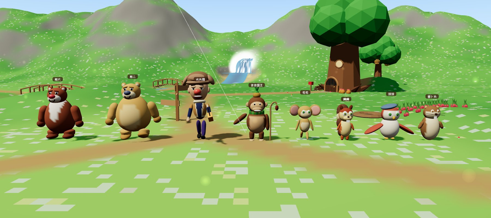

# 熊出没 · 四季狗熊岭 3D 地图

以《熊出没》四季篇（《春日对对碰》2014、《冬日乐翻天》2015、《夏日连连看》2016、《秋日团团转》2016）为灵感的狗熊岭三维地图模型。整片森林做成一块立体沙盘，可在春、夏、秋、冬之间平滑切换，也可切换白天与夜晚。


## 打开方式

- **直接打开**：双击 [`docs/index.html`](docs/index.html)。单文件，约 0.7 MB，地形和模型都在浏览器里实时生成，不需要服务器。
- **GitHub Pages**：发布本目录下的 `docs/` 即可得到在线地址。
- 需要支持 WebGL 2 的浏览器。

操作：拖动旋转，滚轮缩放，右键平移。底部四个按钮或数字键 1–4 切换季节；空格键开关“四季自动轮换”（默认每 16 秒换一季）；N 切换昼夜；R 回到全景。点击地名飞往该处并显示当季说明，点击角色名或“索引”里的角色可跟随角色移动。

## 地图内容

| 地点 | 说明 |
|---|---|
| 熊大熊二的家 | 巨大老树的树洞，树根间开拱形木门，树干上有小圆窗，门前有信箱、柴堆和蜂蜜罐 |
| 光头强的木屋 | 暗红色木板墙、凹凸不平的灰蓝色石板屋顶和老虎窗、绿色格子门窗，门边挂红辣椒串；院里停着他的蓝色四驱皮卡，旁边是木材堆和围栏 |
| 吉吉和毛毛的山洞 | 西边山坡上的石洞（熊大熊二帮它们建的），洞口有吉吉的石头宝座和一堆果子 |
| 涂涂的树屋 | 小溪东岸大树上的小木屋 |
| 蹦蹦的树洞 | 木桥西边大松树上的树洞，树下堆满松果 |
| 萝卜头的地洞 | 花海草甸东边的地洞和萝卜地 |
| 蜂蜜树 | 树洞家后面挂着一圈圈蜂巢的老树，周围有蜜蜂 |
| 伐木场 | 木屋东边的树桩空地和原木堆 |
| 山间瀑布、小溪木桥、林中大湖 | 瀑布发源的小溪穿过森林汇入湖泊，湖边有码头和木船 |
| 花海草甸 | 森林中央的开阔草地，几条小路交汇 |
| 狗熊岭主峰、松林、出山公路 | 北边山脊、以云杉和落叶松为主的针叶林、通往山外的土路和寨门 |



| 角色 | 造型 | 活动 |
|---|---|---|
| 熊大 | 红棕色毛，胸前大片白色 V 字毛，白口鼻、红色大鼻子、厚嘴唇，梨形身材 | 在树洞家—木桥—吉吉的山洞之间巡山 |
| 熊二 | 金黄色毛，浅色肚皮，灰蓝色大鼻子，比哥哥更胖 | 在树洞家和蜂蜜树之间来回 |
| 光头强 | 瘦小、大脑袋、红鼻子、细胡子，棕色毛皮护耳帽，深蓝毛衣外套黄棕色毛边短夹克，紫色裤子，黑鞋，拿电锯 | 在木屋、柴堆、皮卡和伐木场之间忙活 |
| 吉吉国王 | 棕色猴子，浅色肚皮和脸，头顶菠萝当王冠，树叶项链，挂着松果的弯木杖 | 在山洞口巡视 |
| 毛毛 | 金色小猴，粉色大圆耳朵，绿色大眼睛，一圈圈的尾巴 | 在吉吉身边蹦来蹦去 |
| 蹦蹦 | 橙黄色松鼠，奶黄色脸和肚皮，两颗大门牙，棕色条纹大尾巴 | 在自己的树洞前蹦跳 |
| 涂涂 | 红白相间的猫头鹰，绿眼睛黄嘴，戴灰蓝色贝雷帽 | 在草甸上空盘旋 |
| 萝卜头 | 棕色地鼠，白肚皮，大门牙，胡须 | 不时从地洞里探出头 |

冬天熊大、熊二和光头强会围上围巾。


## 四季变化

| | 春 · 春日对对碰 | 夏 · 夏日连连看 | 秋 · 秋日团团转 | 冬 · 冬日乐翻天 |
|---|---|---|---|---|
| 树木 | 嫩绿，部分开粉花 | 浓绿 | 落叶松金黄，阔叶树橙红 | 阔叶树和落叶松落光，云杉压雪 |
| 地面 | 草地上开满野花 | 深绿草地 | 枯黄草地、满地落叶 | 积雪，雪落在所有朝上的表面 |
| 水面 | 流动 | 流动，荷叶、小船 | 流动，小船 | 湖面、小溪、瀑布全部结冰 |
| 天空 | 飘落的花瓣、风筝 | 夜里萤火虫 | 飘落的树叶 | 下雪 |
| 道具 | — | 晾衣绳 | 草垛、南瓜、蘑菇 | 雪人、屋檐冰凌 |

季节之间的过渡是连续的：颜色、积雪、树冠大小、粒子和道具都随季节位置插值。

## 开发

```bash
npm install
npm run dev     # http://localhost:5174
npm run build   # 生成单文件 docs/index.html
```

| 文件 | 内容 |
|---|---|
| `src/places.js` | 地图布局：湖、小溪、道路、空地、山丘，地点与各季说明 |
| `src/seasons.js` | 四季调色板与季节插值 |
| `src/shared.js` | 共享 uniform 与“积雪”着色器补丁 |
| `src/terrain.js` | 程序生成的高程、地面着色器、沙盘侧壁与底座、水面/冰面/瀑布 |
| `src/flora.js` | 实例化的云杉、落叶松、阔叶树、白桦、灌木、岩石和野花 |
| `src/buildings.js` | 光头强的木屋和皮卡、树洞家、山洞、树屋、蜂蜜树、木桥、码头及季节道具 |
| `src/characters.js` | 八个角色的程序化造型（变形球体 + 顶点着色画出毛色分区）与动作 |
| `src/particles.js` | 花瓣、萤火虫、落叶、雪花、炊烟、蜜蜂、瀑布水雾 |
| `src/ui.js` | 标题、季节切换、工具按钮、索引、地点卡片、地图标注 |

## 还原程度与参考资料

我看不了视频，所以是对照动画的静帧和官方角色图来建模的：

- [熊出没 Boonie Bears 粉丝维基](https://booniebears.fandom.com/) 上第一季第一集的 83 张截图、第一季片头的 40 张截图，以及《春日对对碰》《夏日连连看》《秋日团团转》《冬日乐翻天》四部的海报；
- [另一个粉丝维基](https://boonie-bears.fandom.com/) 上的角色立绘和全家福（光头强木屋前的合影）；
- 两个维基和[维基百科](https://en.wikipedia.org/wiki/Boonie_Bears)的角色文字介绍。

据此对照修正的内容：熊大的白色 V 字胸毛和红鼻子、熊二的灰蓝色鼻子；光头强的毛皮护耳帽、深蓝毛衣加毛边短夹克、紫色裤子、红鼻子；他开的是蓝色四驱皮卡；他的木屋是暗红色木板墙、灰蓝色石板屋顶、绿色格子门窗、门边挂辣椒；吉吉的菠萝王冠、树叶项链和挂松果的木杖；毛毛的粉色大圆耳朵；蹦蹦住在堆满松果的树洞里；吉吉和毛毛住山洞，涂涂住树屋；森林以高大的针叶树为主；蜂巢是一圈圈叠起来的样子。

仍然做不到 1:1 的地方：

- **地图布局**：动画没有公开的狗熊岭全图，各集里场景的相对位置也不固定，地点的位置和地形是我安排的。
- **造型精度**：角色是用变形球体和胶囊体拼出来的，比例和颜色对照了参考图，但达不到动画里精细建模和毛发渲染的程度；没有使用任何官方模型或素材。
- **没找到参考图的**：熊大熊二树洞的外观（只看到片头里树洞内部）、山洞和树屋的具体样子、瀑布和湖，这些按角色设定做了合理推断。
- 四季说明文字是我写的地点描述，不是剧集情节。

## 说明

这是非官方的同人作品。《熊出没》及其角色版权归华强方特所有。地图的地形和地点布局是演绎，不是官方设定；角色和建筑对照动画截图用几何体塑造，没有使用任何官方模型、贴图或素材，仓库里也不包含任何动画截图。三维引擎为 three.js（MIT），标题字体在联网时使用 Google Fonts 的站酷快乐体（SIL OFL），离线时使用系统字体。
