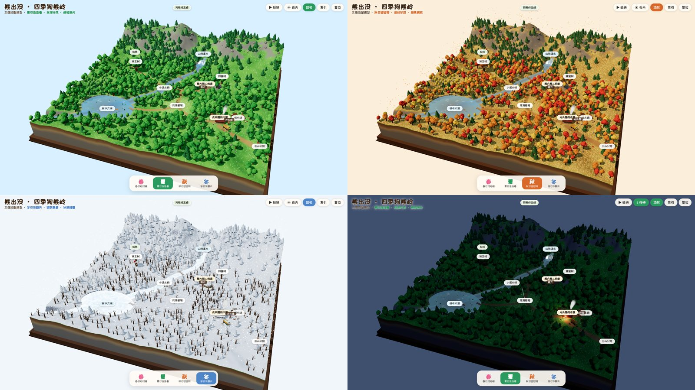
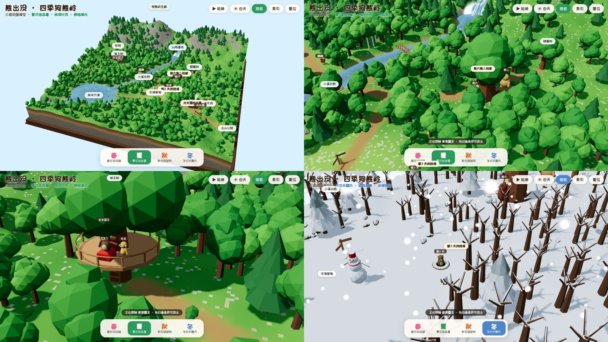

# 熊出没 · 四季狗熊岭 3D 地图

以《熊出没》四季篇（《春日对对碰》2014、《冬日乐翻天》2015、《夏日连连看》2016、《秋日团团转》2016）为灵感的狗熊岭三维地图模型。整片森林做成一块立体沙盘，可在春、夏、秋、冬之间平滑切换，也可切换白天与夜晚。



## 打开方式

- **直接打开**：双击 [`docs/index.html`](docs/index.html)。单文件，约 0.7 MB，地形和模型都在浏览器里实时生成，不需要服务器。
- **GitHub Pages**：发布本目录下的 `docs/` 即可得到在线地址。
- 需要支持 WebGL 2 的浏览器。

操作：拖动旋转，滚轮缩放，右键平移。底部四个按钮或数字键 1–4 切换季节；空格键开关“四季自动轮换”（默认每 16 秒换一季）；N 切换昼夜；R 回到全景。点击地名飞往该处并显示当季说明，点击角色名或“索引”里的角色可跟随角色移动。

## 地图内容

| 地点 | 说明 |
|---|---|
| 熊大熊二的家 | 巨大老树的树洞，树根间开拱形木门，树干上有小圆窗，门前有信箱、柴堆和蜂蜜罐 |
| 萝卜头的地洞 | 花海草甸东边的地洞和萝卜地 |
| 蜂蜜树 | 熊窝后面挂着三个蜂巢的老树，周围有蜜蜂飞舞 |
| 光头强的木屋 | 东南边的原木小屋，带门廊、烟囱、伐木车、木材堆和围栏 |
| 伐木场 | 木屋东边的树桩空地和原木堆 |
| 山间瀑布 | 主峰南坡的瀑布与水潭，小溪由此发源 |
| 小溪木桥 | 横跨小溪的拱桥（上游还有一座小桥） |
| 林中大湖 | 小溪汇入的湖泊，有小码头和木船 |
| 花海草甸 | 森林中央的开阔草地，几条小路交汇 |
| 猴王树 | 西边的大树，树上有吉吉国王的宝座平台和梯子 |
| 狗熊岭主峰、松林、出山公路 | 北边山脊、山脚常绿松林、通往山外的土路和寨门 |

角色：

| 角色 | 造型 | 活动 |
|---|---|---|
| 熊大 | 红棕色毛 | 在树洞—木桥—猴王树之间巡山 |
| 熊二 | 浅黄棕色毛，比哥哥更壮实 | 在树洞和蜂蜜树之间来回 |
| 光头强 | 秃顶、红鼻子，戴黄色安全帽（冬天换成棉帽），穿夹克和牛仔裤，拿电锯 | 在木屋、柴堆、卡车和伐木场之间忙活 |
| 吉吉国王 | 戴王冠的猴子 | 坐在猴王树平台的宝座上 |
| 毛毛 | 金色小猴子 | 站在吉吉国王身边 |
| 蹦蹦 | 红松鼠，大门牙 | 在木桥西边的林子里蹦跳 |
| 涂涂 | 仓鸮（猫头鹰），唯一会飞的角色 | 在花海草甸上空盘旋 |
| 萝卜头 | 地鼠 | 不时从地洞里探出头 |

冬天熊大、熊二和光头强会围上围巾。



## 四季变化

| | 春 · 春日对对碰 | 夏 · 夏日连连看 | 秋 · 秋日团团转 | 冬 · 冬日乐翻天 |
|---|---|---|---|---|
| 树木 | 嫩绿，部分开粉花 | 浓绿 | 橙、红、金黄 | 阔叶树落光，松枝压雪 |
| 地面 | 草地上开满野花 | 深绿草地 | 枯黄草地、满地落叶 | 积雪，雪落在所有朝上的表面 |
| 水面 | 流动 | 流动，荷叶、小船 | 流动，小船 | 湖面、小溪、瀑布全部结冰 |
| 天空 | 飘落的花瓣、风筝 | 夜里萤火虫 | 飘落的树叶 | 下雪 |
| 道具 | — | 晾衣绳 | 草垛、南瓜、蘑菇 | 雪人、屋檐冰凌 |

季节之间的过渡是连续的：颜色、积雪、树冠大小、粒子和道具都随季节位置插值。

## 开发

```bash
npm install
npm run dev     # http://localhost:5174
npm run build   # 生成单文件 docs/index.html
```

| 文件 | 内容 |
|---|---|
| `src/places.js` | 地图布局：湖、小溪、道路、空地、山丘，地点与各季说明 |
| `src/seasons.js` | 四季调色板与季节插值 |
| `src/shared.js` | 共享 uniform 与“积雪”着色器补丁 |
| `src/terrain.js` | 程序生成的高程、地面着色器、沙盘侧壁与底座、水面/冰面/瀑布 |
| `src/flora.js` | 实例化的松树、阔叶树、白桦、灌木、岩石和野花 |
| `src/buildings.js` | 木屋、熊窝、蜂蜜树、猴王树、木桥、码头、伐木车及季节道具 |
| `src/characters.js` | 熊大、熊二、光头强的简模与巡游路线 |
| `src/particles.js` | 花瓣、萤火虫、落叶、雪花、炊烟、蜜蜂、瀑布水雾 |
| `src/ui.js` | 标题、季节切换、工具按钮、索引、地点卡片、地图标注 |

## 还原程度

动画里没有公开的狗熊岭全图，各集场景的相对位置也不固定，官方三维模型和设定图也拿不到，所以这张地图做不到 1:1 复原。下面分开说明哪些有资料依据，哪些是演绎：

- **有资料依据**：熊大熊二住在树洞里；熊大红棕色、熊二浅黄棕色且更壮；光头强秃顶，戴安全帽或护耳棉帽遮秃，穿夹克和牛仔裤，带电锯，开卡车进出森林，受李老板雇佣；蹦蹦是大门牙的松鼠，吉吉是自称国王的猴子，毛毛是金色小猴，涂涂是猫头鹰、唯一会飞，萝卜头是爱囤萝卜、会打洞的地鼠；四季篇各部的年份。资料来源：[维基百科《熊出没》](https://zh.wikipedia.org/wiki/熊出没)、[Boonie Bears (Wikipedia)](https://en.wikipedia.org/wiki/Boonie_Bears)。
- **演绎**：所有地点的位置和地形，瀑布、湖、木桥、蜂蜜树、猴王树平台、萝卜地等具体样子，光头强夹克和安全帽的颜色，各地点的四季说明文字，以及所有角色的具体造型比例。

如果能提供动画截图（例如树洞正面、光头强木屋、角色正侧面），可以照着截图继续修正。

## 说明

这是非官方的同人作品。《熊出没》及其角色版权归华强方特所有。地图的地形和地点布局是根据动画印象所做的演绎，不是官方设定；角色用球体、胶囊体等几何体简单塑造，没有使用任何官方模型或素材。三维引擎为 three.js（MIT），标题字体在联网时使用 Google Fonts 的站酷快乐体（SIL OFL），离线时使用系统字体。
