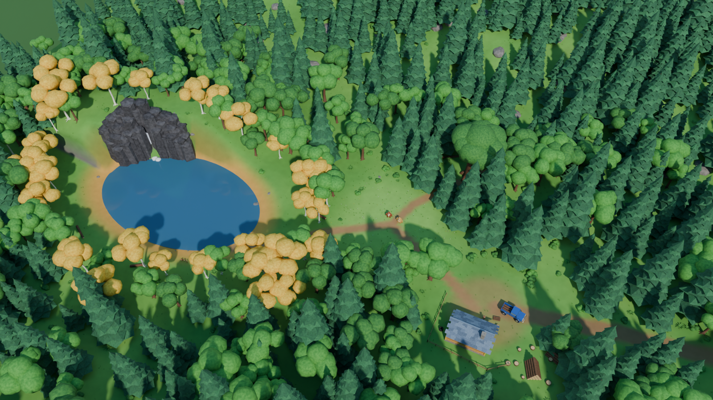
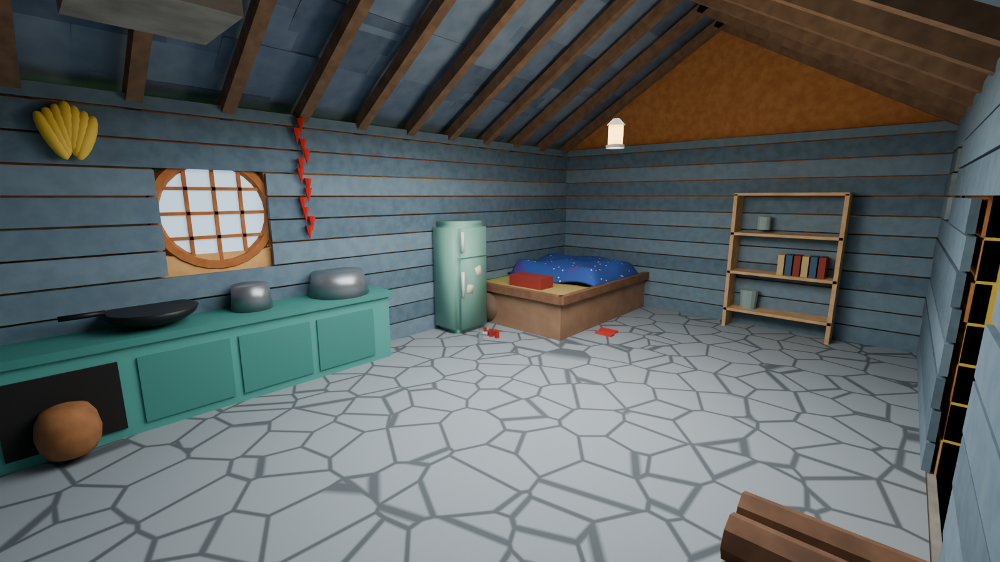
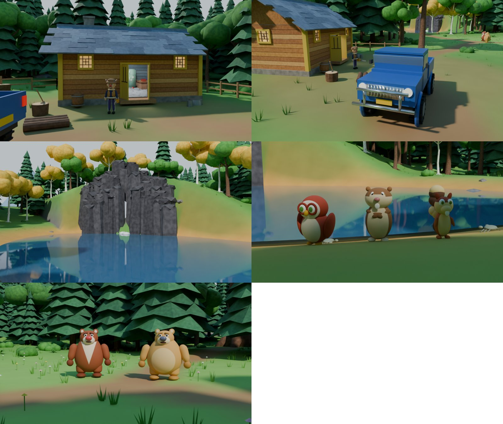

# 熊出没 · 狗熊岭森林 3D 地图（Blender 版）







## 交付文件

| 文件 | 说明 |
|---|---|
| `build_boonie_bears_map.py` | 自动建模脚本，从零生成整个场景并保存 `.blend` |
| `boonie_bears_forest_map.blend` | 生成好的场景文件（Blender 4.5.9 LTS 生成并重新打开检查过） |
| `preview.png` | 地图总览渲染（Cycles，1600×900） |
| `preview_interior.png` | 木屋室内相机渲染 |
| `preview_views.jpg` | 其余 5 个相机的低采样预览 |
| `REFERENCE_NOTES.md` | 参考清单、冲突取舍、比例与布局（.blend 里的文本块 `Reference_Notes.md` 也是这份内容） |

## 打开文件

1. 安装 Blender 4.2 LTS 或更新版本（在 4.5.9 LTS 上生成和测试）。
2. 双击 `boonie_bears_forest_map.blend`，或在 Blender 里 文件 → 打开。
3. 文件里没有外部贴图、字体或图片路径，所有材质都是程序化节点，打开不会有丢失文件的提示。

如果你的 Blender 版本打不开这个文件，或者想重新生成：

- **图形界面**：切到 Scripting 工作区 → 打开 `build_boonie_bears_map.py` → 点 Run Script。脚本会清空当前场景、重建，并把 `boonie_bears_forest_map.blend` 保存在脚本所在目录（脚本未保存在磁盘上时，保存到当前 .blend 所在目录或用户主目录）。在 4.5 上约 5 秒。
- **命令行**：
  ```bash
  blender -b -P build_boonie_bears_map.py -- --out boonie_bears_forest_map.blend \
          --render preview.png --render-interior preview_interior.png --samples 48
  ```
  可选参数：`--res 1920x1080`。

脚本可以重复运行，每次都会先清空再重建，不会产生重复物体。

## 移动视角

| 操作 | 按键 |
|---|---|
| 旋转视角 | 按住鼠标中键拖动 |
| 平移 | Shift + 中键拖动 |
| 缩放 | 滚轮 |
| 聚焦选中物体 | 小键盘 `.` |
| 通过当前相机看 | 小键盘 `0` |
| 切换到某个相机 | 在大纲视图里选中相机 → `Ctrl + 小键盘 0` |
| 第一人称漫游 | `Shift + ~`，WASD 移动，鼠标转向 |
| 实时渲染预览 | 视图右上角选“渲染预览”（Rendered） |

相机都在 `Lights_and_Cameras` 集合：

| 相机 | 画面 |
|---|---|
| `Cam_Map_Overview` | 地图总览（默认相机） |
| `Cam_House_Interior` | 木屋室内：灶台、绿冰箱、土炕、储物架 |
| `Cam_House_Exterior` | 木屋正面（对照 U3） |
| `Cam_Pickup_Yard` | 院子和皮卡 |
| `Cam_Lake_Beach` | 湖边沙滩看石崖瀑布（对照 U1） |
| `Cam_TuTu_LuoBoTou_BengBeng` | 涂涂、萝卜头、蹦蹦（对照 U2） |
| `Cam_Characters_Meadow` | 空地上的熊大熊二 |

**看木屋内部**：在大纲视图里点掉 `GuangtouQiang_House_Exterior / GQ_House_Roof_Removable` 集合的眼睛图标，屋顶、山墙、烟囱和椽子会一起隐藏，从上往下就能看到整个室内。室内相机在屋里，不用拆屋顶也能看到家具。

## 修改模型

- **场景结构**：

  | 集合 | 内容 |
  |---|---|
  | `Terrain` | 地形、远山、远处地面 |
  | `Forest_Trees` | 树木；其中子集合 `Bears_TreeHome` 是熊大熊二的树洞 |
  | `Forest_Plants` | 灌木、蕨类、草丛与野花、倒木 |
  | `River_and_Rocks` | 湖、石崖、瀑布、岩石 |
  | `GuangtouQiang_House_Exterior` | 木屋外观；其中子集合 `GQ_House_Roof_Removable` 是可隐藏的屋顶 |
  | `GuangtouQiang_House_Interior` | 室内墙板、家具、室内灯 |
  | `Characters` | 每个角色一个子集合 |
  | `Vehicles` | 皮卡 |
  | `Props` | 院子里的道具、蜂巢、螃蟹、栅栏 |
  | `Lights_and_Cameras` | 太阳、相机 |
  | `Reference_Notes` | 说明、推测模型集合、隐藏的树木原型 |
- **整体移动**：木屋、皮卡、树洞、每个角色都有一个 `_Root` 空物体，其余部件都挂在它下面；移动或旋转 `_Root` 就能整体移动。
- **中文名称与依据**：选中物体 → 属性面板 → 物体 → 自定义属性：
  - `name_cn`：中文名。
  - `ref_status`：`observed` 表示剧照可见，`inferred` 表示推测。
  - `ref_note`：依据说明。
- **推测模型**：都同时链接进 `Reference_Notes/Inferred_Models` 集合。在大纲视图里右键这个集合 → 选择物体，就能一次选中全部推测模型，方便替换。
- **树木和植物**：同一种树共用一份网格，是“关联复制”。改一棵树的形状，同类的树会一起改；只想改一棵时，选中后按 `F3` 搜“设为单用户”（Make Single User）。原型网格在隐藏集合 `Reference_Notes/Prototypes_Hidden` 里。
- **材质**：每种材质都有清楚的英文名，例如：
  - `Paint_Fridge_Mint`：冰箱
  - `Fabric_Quilt_BlueFloral`：被子
  - `Wood_Plank_Exterior_0…3`：外墙木板
  - `XiongDa_Fur_With_Bib`：熊大的毛色和胸前 V 字

  在“着色”工作区修改。熊大胸前 V 字、熊二肚皮等毛色分区是着色器里按物体坐标画的平滑色块。
- **门**：`GQ_Door_Leaf_Left/Right` 的原点在铰链上，绕 Z 轴旋转即可开关门。
- **角色细化**：角色由多个独立部件组成（头、口鼻、眼睛、耳朵、四肢、手掌、脚掌、衣服、帽子等），部件都带细分修改器。可以把某个角色的部件合并后进入雕刻模式继续塑形，见下文“未完成内容”。

## 比例

- 1 Blender unit = 1 m，单位制为公制。
- 比例基准：熊大身高 2.0 m（资料中的“约 2 米”）。
- 其余尺寸都是估算，详见 `REFERENCE_NOTES.md`。例如：
  - 光头强高 1.55 m
  - 木屋 9 × 6 m，墙高 3 m，双开门 1.7 × 2.1 m
  - 皮卡长 5.2 m，轮胎直径 0.96 m
- 网格按 0.05–0.1 m 级精度建模。这只是模型精度，不代表动画有这样精确的官方尺寸。

## 完成情况

**依据剧照制作（observed）**
- 木屋正面：
  - 墙面和门窗：橙黄横木板、黄色包角和门窗框、黄色对开门（向外开）、小方格窗。
  - 门内和门前：门内的柴火堆；门前的铁皮盆、铁桶、木桶、劈柴木墩和斧头、原木。
- 木屋室内：
  - 墙和地面：蓝灰色木板内墙、灰色石板地面。
  - 土炕：竹席、蓝底白花打补丁的被子、红枕头、红拖鞋。
  - 冰箱一角：圆角绿冰箱（门上贴纸条）、易拉罐、陶罐。
  - 灶台一角：青绿色灶台、炒锅、汤锅、水盆、小木桶、圆形格子窗、辣椒串、玉米、碗架。
  - 储物和照明：储物架、碗柜、马灯、室内椽子。
- 院子外：轮胎堆、绿色水管、原木堆。
- 湖：沙滩、螃蟹、深灰色柱状石崖、从崖顶落进湖里的瀑布、湖边金黄色白桦。
- 森林：以云杉为主，夹杂圆冠阔叶树；远处蓝色群山。
- 角色：
  - 熊大：红棕色，奶白 V 字胸毛，红鼻子。
  - 熊二：金棕色，浅色肚皮，灰蓝鼻子，更胖。
  - 光头强：护耳棉帽，深蓝毛衣，毛边短夹克，紫色白条运动裤，黑鞋，红鼻子，小胡子，电锯。
  - 涂涂、萝卜头（双手抱胸）、蹦蹦：按 U2。
- 蜂巢：一圈圈叠起来的锥形。

**推测内容（inferred）**
- 整张地图的布局和地形起伏，地点之间的位置关系。
- 木屋的侧面、背面、屋顶形状和灰蓝色石板瓦、石头地基、烟囱、台阶。
- 室内家具的具体位置（剧照只能看到局部）。
- 熊大熊二的树洞外观（只有“住在树洞里”的资料）、蜂蜜树。
- 蓝色皮卡：只在第一季出现，四季篇是否同一辆车无法确认。
- 木栅栏、树桩、倒木、灌木、蕨类、草丛、岩石的分布。
- 所有尺寸（除熊大身高）。

**未完成，需要手工继续**
- 角色是参数化几何体拼成的，轮廓、比例、配色和主要特征已经对上，但面部表情、嘴型、手指、毛发质感、衣服褶皱还需要在雕刻模式里手工细化。
- 角色没有骨骼绑定，目前是固定站姿。
- 树叶是团块和枝层造型，没有逐片叶子。远看效果好，近景特写还需要换成更细的树。
- 室内只有一个大房间。U4 的浅木色储物间可能是另一个房间，因为缺少平面关系，没有单独隔出。
- 没有做季节变化（场景是初秋：云杉常绿，湖边白桦变黄）。

## 还需要的剧照角度

有下面这些画面，可以把推测部分换成依据剧照的模型：

1. 光头强木屋的**侧面和背面**，以及**没有积雪时的屋顶**（形状、材料、烟囱位置）。
2. 木屋**室内全景**或能看出房间之间关系的镜头（炕、灶台、冰箱、储物间分别在哪面墙）。
3. 熊大熊二**树洞的外观**（门、窗、树的形状）。
4. 四季篇里光头强的**车**（是否还是第一季那辆蓝色皮卡，侧面和车尾）。
5. 熊大、熊二、光头强的**正面、侧面、背面**全身图（用于校正比例和细节）。
6. 能看出**地点之间相对位置**的远景或俯视镜头（木屋、树洞、湖、空地之间的方位）。
7. 湖和石崖的**其他角度**（湖的另一侧、瀑布上游）。
8. 蜂蜜树、熊大熊二家门口的环境镜头。

## 说明

这是非官方同人作品，用于学习交流。《熊出没》及其角色版权归华强方特所有。本场景没有使用任何官方模型、贴图或素材，仓库里也不包含任何动画截图。
