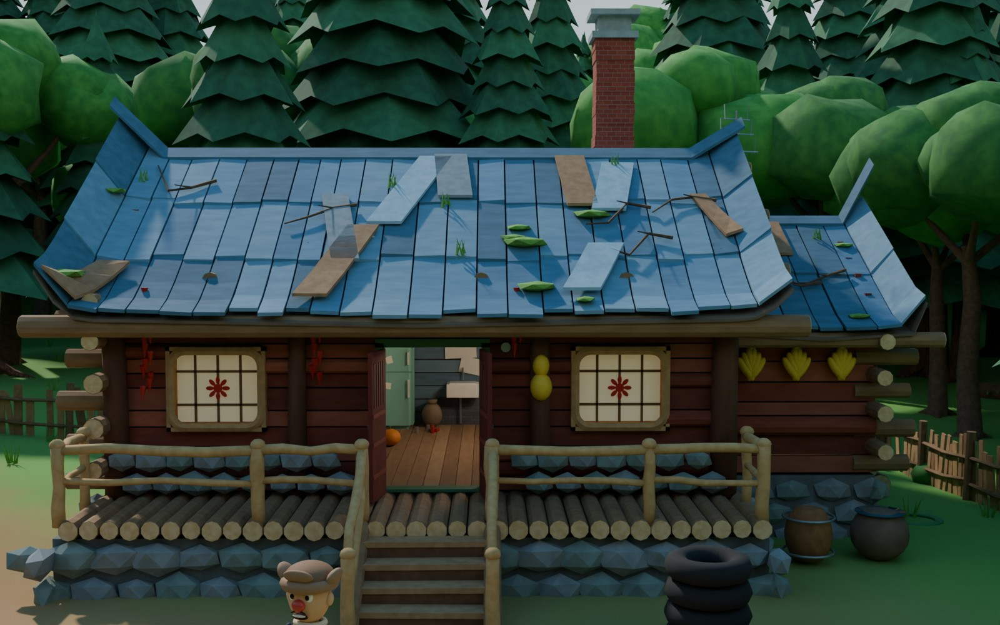
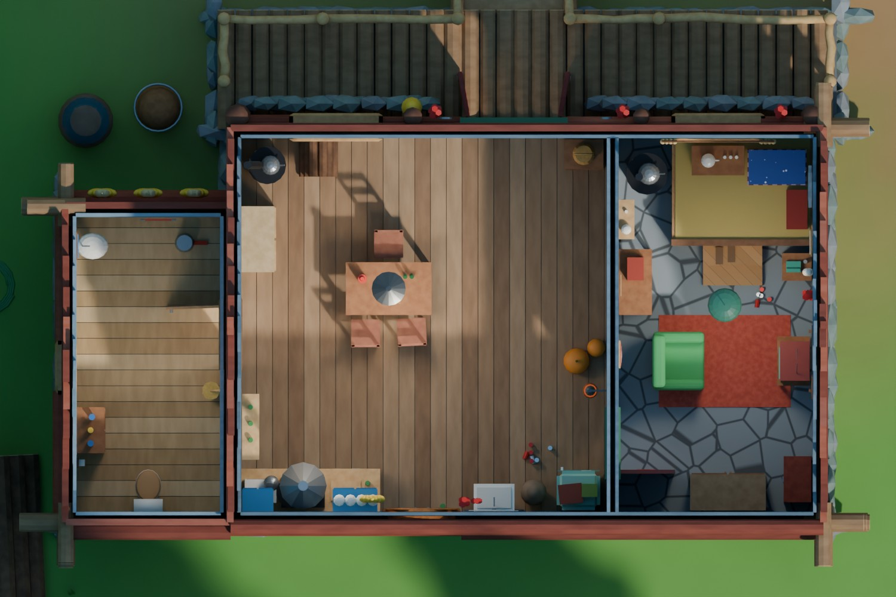
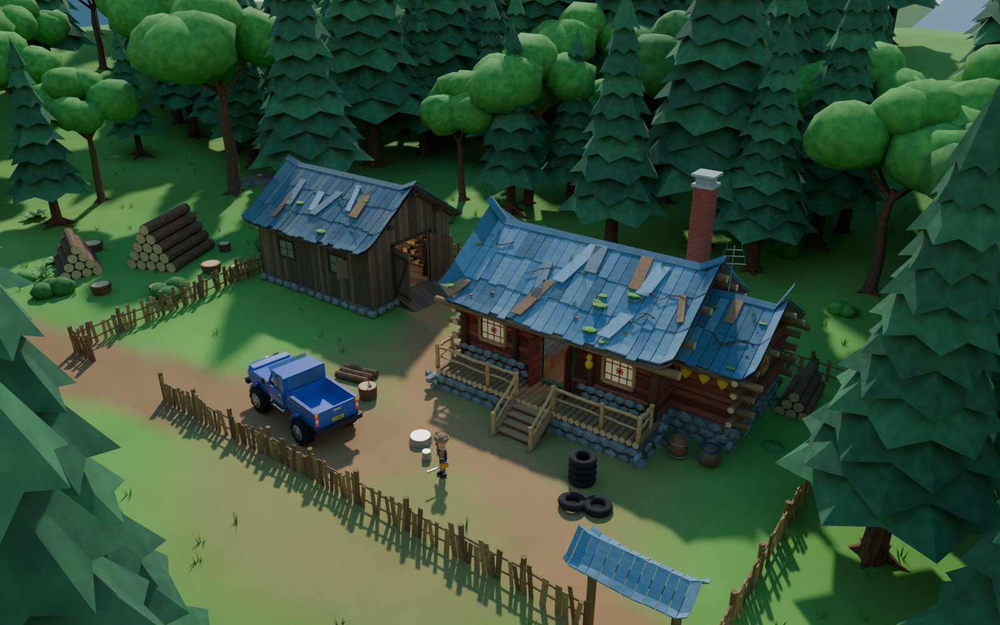
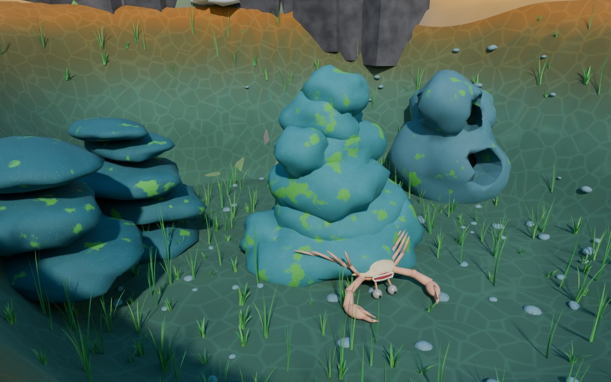
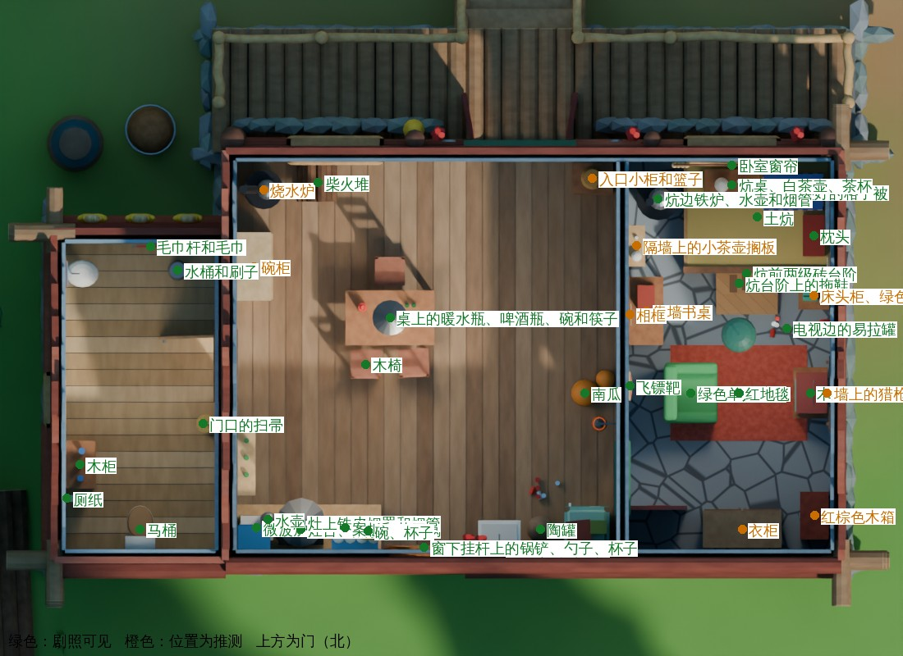

# 熊出没 · 狗熊岭森林 3D 地图（Blender 版）


木屋和仓库验收图（`acceptance/`）：





湖底预览（`lake_checks/`，低材质，湖底形状为推测，见 `LAKE_AUDIT.md`）：



## 交付文件

| 文件 | 说明 |
|---|---|
| `build_boonie_bears_map.py` | 自动建模脚本，从零生成整个场景并保存 `.blend` |
| `boonie_bears_forest_map.blend` | 生成好的场景文件（Blender 4.5.9 LTS 生成并重新打开检查过） |
| `preview.png` | 地图总览渲染（Cycles，1600×900） |
| `preview_interior.png` | 木屋室内相机渲染 |
| `preview_views.jpg` | 其余 5 个相机的低采样预览 |
| `REFERENCE_CATALOG.md` | 参考图逐张核对清单：参考图—对应物体—可确认细节—看不清的部分 |
| `render_checks.py` | 渲染全部检查视图（正交相机） |
| `render_acceptance.py` | 渲染木屋和仓库的验收图（`Acceptance_Cameras` 里的 17 台相机） |
| `acceptance/` | 验收图：木屋四面、屋顶近景、室内俯视、厨房、卧室、卫生间、仓库四面、仓库内部、储物细节、院落总览 |
| `HOUSE_WAREHOUSE_AUDIT.md` | 木屋和仓库修正前的参考读取情况、版本冲突和错误对照表 |
| `reopen_check.py` | 重新打开 .blend 后的完整检查：缺失贴图、重复物体、家具悬空/穿插、门洞被挡 |
| `LAKE_AUDIT.md`、`lake_layout_diagrams.py`、`lake_checks/` | 湖泊和湖底：原片读取情况、结构草图（平面等深线、剖面）、低材质预览 |
| `make_check_sheets.py` | 把检查视图拼成检查图（需要 Pillow） |
| `checks/` | 检查图：人物正侧背、皮卡四视图、木屋四视图、室内平面（带标注）、地图俯视 |
| `REFERENCE_NOTES.md` | 参考清单、冲突取舍、比例与布局（.blend 里的文本块 `Reference_Notes.md` 也是这份内容） |

## 打开文件

1. 安装 Blender 4.2 LTS 或更新版本（在 4.5.9 LTS 上生成和测试）。
2. 双击 `boonie_bears_forest_map.blend`，或在 Blender 里 文件 → 打开。
3. 文件里没有外部贴图、字体或图片路径，所有材质都是程序化节点，打开不会有丢失文件的提示。

如果你的 Blender 版本打不开这个文件，或者想重新生成：

- **图形界面**：切到 Scripting 工作区 → 打开 `build_boonie_bears_map.py` → 点 Run Script。脚本会清空当前场景、重建，并把 `boonie_bears_forest_map.blend` 保存在脚本所在目录（脚本未保存在磁盘上时，保存到当前 .blend 所在目录或用户主目录）。在 4.5 上约 5 秒。
- **命令行**：
  ```bash
  blender -b -P build_boonie_bears_map.py -- --out boonie_bears_forest_map.blend \
          --render preview.png --render-interior preview_interior.png --samples 48
  ```
  可选参数：`--res 1920x1080`。

脚本可以重复运行，每次都会先清空再重建，不会产生重复物体。

## 检查视图

`Lights_and_Cameras/Check_Cameras` 里有 28 个正交相机：

- 每个人物 3 个：正面、侧面、背面。
- 皮卡 4 个、木屋 4 个：正面、侧面、背面、俯视。
- 室内平面 1 个（渲染时会自动隐藏屋顶）。
- 地图俯视 1 个。

这些相机的裁剪范围只包住目标物体，所以周围的树不会挡住画面。

```bash
blender -b boonie_bears_forest_map.blend -P render_checks.py -- checks_out 24
python3 make_check_sheets.py checks_out checks
```

| 检查图 | 内容 |
|---|---|
| `checks/check_map_top.jpg` | 整体俯视 |
| `checks/check_characters.jpg` | 六个人物的正面、侧面、背面 |
| `checks/check_pickup_4views.jpg` | 皮卡正面、侧面、车尾、俯视 |
| `checks/check_house_exterior.jpg` | 木屋正面、东侧、背面、俯视 |
| `checks/check_house_interior_plan_labeled.jpg` | 室内平面图。绿色标注：位置能从剧照解释；橙色：位置为推测 |



## 移动视角

| 操作 | 按键 |
|---|---|
| 旋转视角 | 按住鼠标中键拖动 |
| 平移 | Shift + 中键拖动 |
| 缩放 | 滚轮 |
| 聚焦选中物体 | 小键盘 `.` |
| 通过当前相机看 | 小键盘 `0` |
| 切换到某个相机 | 在大纲视图里选中相机 → `Ctrl + 小键盘 0` |
| 第一人称漫游 | `Shift + ~`，WASD 移动，鼠标转向 |
| 实时渲染预览 | 视图右上角选“渲染预览”（Rendered） |

相机都在 `Lights_and_Cameras` 集合：

| 相机 | 画面 |
|---|---|
| `Cam_Map_Overview` | 地图总览（默认相机） |
| `Cam_House_Interior` | 木屋客厅/厨房：绿冰箱、水槽、圆窗、蓝色橱柜、餐桌 |
| `Cam_House_Exterior` | 木屋正面 |
| `Cam_Pickup_Yard` | 院子和皮卡 |
| `Cam_Lake_Beach` | 湖边沙滩看石崖瀑布（对照 U1） |
| `Cam_TuTu_LuoBoTou_BengBeng` | 涂涂、萝卜头、蹦蹦（对照 U2） |
| `Cam_Characters_Meadow` | 空地上的熊大熊二 |

**验收相机**在 `Lights_and_Cameras/Acceptance_Cameras`（`Acc_01`–`Acc_17`）。渲染：

```
blender -b boonie_bears_forest_map.blend -P render_acceptance.py -- acceptance_out 32
```

每台相机的自定义属性 `hide_collections` 写明渲染时要隐藏的集合（例如室内俯视要拆掉屋顶，木屋东侧要隐藏仓库），`clear_trees` 表示渲染时临时隐藏挡在相机和建筑之间的树。

**看木屋内部**：在大纲视图里点掉 `GuangtouQiang_House_Exterior / GQ_House_Roof_Removable` 集合的眼睛图标，主屋顶、侧翼屋顶、烟囱、天线、檩条和室内横梁会一起隐藏。仓库的屋顶在 `GuangtouQiang_Warehouse / WH_Roof_Removable`。三扇室内门和正门、仓库大门都是打开的，可以直接走进去。

## 修改模型

- **场景结构**：

  | 集合 | 内容 |
  |---|---|
  | `Terrain` | 地形、远山、远处地面 |
  | `Forest_Trees` | 树木；其中子集合 `Bears_TreeHome` 是熊大熊二的树洞 |
  | `Forest_Plants` | 灌木、蕨类、草丛与野花、倒木 |
  | `River_and_Rocks` | 湖、石崖、瀑布、岩石 |
  | `GuangtouQiang_House_Exterior` | 木屋外观：石头基座、红棕色木墙、门窗、露台、楼梯、栏杆、屋檐装饰；子集合 `GQ_House_Roof_Removable` 是可隐藏的屋顶 |
  | `GuangtouQiang_House_Interior` | 室内墙板；子集合 `GQ_Room_Kitchen_Dining`（客厅/厨房/餐厅）、`GQ_Room_Bedroom`（卧室）、`GQ_Room_Bathroom`（卫生间，侧翼） |
  | `GuangtouQiang_Warehouse` | 独立仓库（整栋为推测）；子集合 `WH_Roof_Removable`（屋顶）、`WH_Interior`（地板、木料架、货架、工作台、工具等） |
  | `Characters` | 每个角色一个子集合 |
  | `Vehicles` | 皮卡 |
  | `Props` | 院子里的道具、蜂巢、螃蟹、栅栏 |
  | `Lights_and_Cameras` | 太阳、相机 |
  | `Reference_Notes` | 说明、推测模型集合、隐藏的树木原型 |
- **整体移动**：木屋（`GQ_House_Root`）、仓库（`Warehouse_Root`）、皮卡、树洞、每个角色都有一个 `_Root` 空物体，其余部件都挂在它下面；移动或旋转 `_Root` 就能整体移动。
- **中文名称与依据**：选中物体 → 属性面板 → 物体 → 自定义属性：
  - `name_cn`：中文名。
  - `ref_status`：`observed` 表示剧照可见，`inferred` 表示推测。
  - `ref_note`：依据说明。
- **推测模型**：都同时链接进 `Reference_Notes/Inferred_Models` 集合。这个集合默认从视图层排除（大纲里复选框未勾选），只当“清单”用，这样隐藏其他集合时物体不会经由它继续显示。要一次选中全部推测模型：勾上它的复选框 → 右键 → 选择物体，用完再取消勾选。
- **树木和植物**：同一种树共用一份网格，是“关联复制”。改一棵树的形状，同类的树会一起改；只想改一棵时，选中后按 `F3` 搜“设为单用户”（Make Single User）。原型网格在隐藏集合 `Reference_Notes/Prototypes_Hidden` 里。
- **材质**：每种材质都有清楚的英文名，例如：
  - `Paint_Fridge_Mint`：冰箱
  - `Fabric_Quilt_BlueFloral`：被子
  - `Wood_Wall_RedBrown_0…4`：木屋外墙
  - `Roof_Board_BlueGrey_0…3`：木屋屋顶木板
  - `XiongDa_Fur_With_Bib`：熊大的毛色和胸前 V 字

  在“着色”工作区修改。熊大胸前 V 字、熊二肚皮等毛色分区是着色器里按物体坐标画的平滑色块。
- **门**：`GQ_Door_Front_Leaf_East/West`、`GQ_Bedroom_Door_Leaf_RedLattice`、`GQ_Bathroom_Door_Leaf`、`Warehouse_Barn_Door_North/South` 的原点都在铰链上，绕 Z 轴旋转即可开关门。
- **室内物体的属性**：`room`（所在房间）、`position_status`（位置是剧照可见还是推测）、`floor_item`（落地家具，质量检查会核对它贴地、不互相穿插、不挡门洞）。
- **角色细化**：角色由多个独立部件组成（头、口鼻、眼睛、耳朵、四肢、手掌、脚掌、衣服、帽子等），部件都带细分修改器。可以把某个角色的部件合并后进入雕刻模式继续塑形，见下文“未完成内容”。

## 比例

- 1 Blender unit = 1 m，单位制为公制。
- 比例基准：熊大身高 2.0 m（资料中的“约 2 米”）。
- 其余尺寸都是估算，详见 `REFERENCE_NOTES.md`。例如：
  - 光头强高 1.55 m
  - 木屋主屋 9 × 6 m，墙高 3 m，地板比院子高约 1 m；卫生间侧翼 2.5 × 4.8 m；正门双开门 1.4 × 2.1 m
  - 仓库 6 × 8 m（推测），墙高 3.2 m，大门 2.6 × 2.7 m
  - 皮卡长 5.2 m，轮胎直径 0.96 m
- 网格按 0.05–0.1 m 级精度建模。这只是模型精度，不代表动画有这样精确的官方尺寸。

## 完成情况

木屋和仓库每一项的依据见 `HOUSE_WAREHOUSE_AUDIT.md`，其余部分见 `REFERENCE_CATALOG.md`。

**依据剧照制作（observed）**
- 木屋外观（R1、R2，四季篇改版）：
  - 红棕色、深浅不一的原木和横木板墙；正面粗细不一、略倾斜的深色木柱。
  - 蓝灰色木板屋顶：长短不一的木板顺坡分层铺设，浅色和木色补丁板，苔藓、草和落下的树枝；两端屋檐上翘，东端翘得更高（不对称）。
  - 右侧（西）较低的侧翼和副屋顶，副屋顶上的电视天线，侧翼正面三串玉米。
  - 高高的红砖烟囱和灰色烟囱帽，在主屋顶靠侧翼一侧、屋脊后面。
  - 山墙外露的檩条圆木头。
  - 绿色门框里的深红色对开门（上部竖条窗）；门两侧圆角方框格子窗，贴红窗花；屋檐下辣椒串、葫芦，门边圆形小牌。
  - 青灰色石头基座，原木铺的露台（前沿露出原木端头），窗下石头矮墙，中间木楼梯，浅色树枝扶手。
  - 歪斜、高低不一的木板栅栏，带蓝色小屋顶的院门，轮胎堆、水缸。
- 客厅/厨房/餐厅（R3、U5、U7）：卧室门洞（绿框、红色格子门）旁的绿色双门冰箱（顶上纸箱），陶罐、易拉罐，挂墙式白水槽和水龙头、墙上旧报纸，圆形格子窗，窗边辣椒和玉米，蓝色橱柜，木椅，门边马灯，南瓜。
- 卧室（R4、E44、U6）：窗下砖砌土炕和炕前台阶、叠好的格子被、枕头、炕桌和白茶壶、炕边带烟管的铁炉和水壶、红地毯上的绿色单人沙发、木架上的老电视、飞镖靶、绿色灯罩吊灯、炕头墙上的日历、旧衣服、辣椒串、蒜辫、绿色电话。
- 院子：铁皮盆、铁桶、木桶、劈柴木墩和斧头、原木、绿色水管、原木堆。
- 湖：沙滩、螃蟹、深灰色柱状石崖、从崖顶落进湖里的瀑布、湖边金黄色白桦。
- 森林：以云杉为主，夹杂圆冠阔叶树；远处蓝色群山。
- 角色：
  - 熊大：红棕色，奶白 V 字胸毛，红鼻子。
  - 熊二：金棕色，浅色肚皮，灰蓝鼻子，更胖。
  - 光头强：护耳棉帽，深蓝毛衣，毛边短夹克，紫色白条运动裤，黑鞋，红鼻子，小胡子，电锯。
  - 涂涂、萝卜头（双手抱胸）、蹦蹦：按 U2。
- 蜂巢：一圈圈叠起来的锥形。

**依据正版授权积木（不是剧照）**
- 一室一厅一卫的布局：卧室在隔墙后，卫生间在侧面单独一翼（R6、R8 文字和俯视图）。
- 卫生间：马桶、角落小洗手池、木柜、扫帚、厕纸、毛巾（R5）。
- 厨房吊柜、微波炉、案板、餐桌和暖水瓶、入口小柜和篮子、进门角落的烧水炉、床头柜、相框、猎枪（R8）。

**推测内容（inferred）**
- **仓库整栋**：动画里没有找到仓库的可用画面。外观（竖木板墙、山墙、对开大门、两侧小窗、木板屋顶）、位置（木屋东侧，大门朝向木屋）和内部布置全部是推测。R7 是玩家复刻，只用来理解“高山墙木板仓库、正中一扇门”的结构，没有照搬。
- 木屋背面、东山墙、屋顶背面坡（剧照只看到正面和侧翼）。
- 卫生间的门、镜子和清洁用品；卧室衣柜和窗帘（剧照里没有，按要求补做）；厨房灶上的铁皮烟罩。
- 院子栅栏的完整走向（只看到正面一段）、从木屋到仓库的小路。
- 整张地图的布局和地形起伏，地点之间的位置关系。
- 熊大熊二的树洞外观、蜂蜜树。
- 蓝色皮卡：只在第一季出现，四季篇是否同一辆车无法确认。
- 所有尺寸（除熊大身高）。

**未完成，需要手工继续**
- 角色是参数化几何体拼成的，轮廓、比例、配色和主要特征已经对上，但面部表情、嘴型、手指、毛发质感、衣服褶皱还需要在雕刻模式里手工细化。
- 角色没有骨骼绑定，目前是固定站姿。
- 树叶是团块和枝层造型，没有逐片叶子。远看效果好，近景特写还需要换成更细的树。
- 网页版（`bears/` 下的 three.js 版本）还是上一轮的木屋，没有同步这次的修正。
- 没有做季节变化（场景是初秋：云杉常绿，湖边白桦变黄）。

## 还需要的剧照角度

有下面这些画面，可以把推测部分换成依据剧照的模型：

1. 光头强木屋的**背面和东侧**、屋顶背面坡。
2. **光头强仓库**的任何动画镜头（外观、大门、内部）。目前整栋是推测。
3. 卫生间、卧室衣柜一侧的动画画面。
4. 熊大熊二**树洞的外观**（门、窗、树的形状）。
5. 四季篇里光头强的**车**（是否还是第一季那辆蓝色皮卡，侧面和车尾）。
6. 熊大、熊二、光头强的**正面、侧面、背面**全身图（用于校正比例和细节）。
7. 能看出**地点之间相对位置**的远景或俯视镜头（木屋、树洞、湖、空地之间的方位）。
8. 湖和石崖的**其他角度**（湖的另一侧、瀑布上游）。
9. 蜂蜜树、熊大熊二家门口的环境镜头。

## 说明

这是非官方同人作品，用于学习交流。《熊出没》及其角色版权归华强方特所有。本场景没有使用任何官方模型、贴图或素材，仓库里也不包含任何动画截图。
